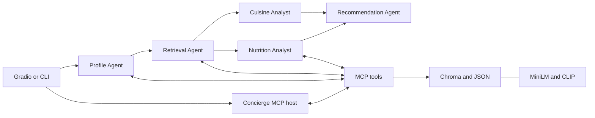

# AI Restaurant & Recipe Recommender

A local-first Python capstone combining multimodal retrieval, five LangGraph
agents, real MCP tool calls, and a Gradio interface. Developed from the concepts
in the Agentic Architecture AI Professional Certificate, with local
Ollama inference replacing the training environment's watsonx integration.

This is a single-user educational portfolio project, not a production service.
It does not require a paid inference API or hosted tracing subscription.

## What this demonstrates

- **Data engineering:** free text to validated JSON, vision-generated captions,
  a shared CRUD store, and timestamped backups.
- **Multimodal RAG:** MiniLM text embeddings, CLIP image embeddings, Chroma,
  metadata filtering, and late-fusion recipe ranking by recipe ID.
- **Agent orchestration:** a sequential chain, parallel analysts, then a join.
- **Tool integration:** agents discover and call a real MCP server over stdio.
  Retrieval is not simulated by asking an LLM to invent restaurants.
- **Observability:** local Phoenix traces plus an in-app agent/tool log.
- **Evaluation:** retrieval metrics, grounding, constraints, output completeness,
  tool usage, latency, data quality, and a local LLM relevance judge.

## Architecture



The retrieval agent uses a bounded tool-calling loop. If it fails to retrieve
candidates, explicit fallback MCP calls use the extracted location and budget.
An empty location result is not silently broadened to another neighborhood.
The cuisine and nutrition nodes execute concurrently in LangGraph; Ollama may
still serialize model inference depending on its configuration and available memory.
Nutrition advice is qualitative, not a verified allergen or medical assessment.

## Quick start on macOS

Use Python **3.12**, Ollama, and two terminal windows. The existing local
environment is already configured; these steps also explain how to recreate it.

```sh
python3.12 -m venv .venv
source .venv/bin/activate
python -m pip install -r requirements.txt
cp .env.example .env
ollama pull qwen3:8b
ollama pull qwen2.5vl:3b
```

Ensure the Ollama desktop app is running (or use `ollama serve` if it is not).
First-time embedding model downloads also need internet access. Inference runs
locally once the models are cached. No Hugging Face token is normally required.

**Dataset prerequisite:** the course inputs are intentionally excluded from Git
until their redistribution terms are verified. The supplied local workspace
already contains them. On another machine, follow [data setup](data/README.md)
before indexing. Do not upload course notebooks or datasets without permission.

```sh
make index          # build/rebuild the three Chroma collections
make app            # open http://localhost:7860
```

In a second terminal, optionally start tracing **before** making requests:

```sh
make phoenix        # open http://localhost:6006
```

Both services stay in their respective terminal; Ctrl-C stops them. They are
not deployed publicly. Do not enable Gradio sharing or expose the MCP tools to
untrusted clients: this local demo has no authentication or authorization.

### Model choice for a 24 GB Apple Silicon Mac

| Purpose | Default | Alternative |
|---|---|---|
| Text, JSON, tool calling | `qwen3:8b` | Existing `llama3.1:8b` |
| Food-image understanding | `qwen2.5vl:3b` | Try `qwen2.5vl:7b` if caption quality justifies more memory |
| Text embeddings | `all-MiniLM-L6-v2` | Keep the same model for indexing and querying |
| Image/text-image embeddings | `openai/clip-vit-base-patch32` | Local CLIP; not the OpenAI API |

Qwen3 thinking is disabled to reduce latency. Start with the two defaults;
larger models compete with CLIP, MiniLM, Chroma, and the UI for memory.
The vision model **understands images; it does not generate them**.
Models have their own licenses; "runs locally" does not itself establish
open-source status or redistribution rights.

### Optional cloud configuration

Change the relevant `TEXT_LLM_*` or `VISION_LLM_*` values in `.env`:

```dotenv
TEXT_LLM_PROVIDER=openai_compatible
TEXT_LLM_MODEL=your-tool-capable-model
TEXT_LLM_API_KEY=your-private-key
TEXT_LLM_BASE_URL=https://your-provider.example/v1
```

Text and vision providers can be switched independently. Providers must support
the required tool-calling, JSON-mode, and/or image-message APIs; compatibility
is not universal. Cloud configurations are placeholders, not cloud-tested
deployments. Enabling one sends prompts and selected records/images to that
provider and may cost money. Never commit `.env` or trace exports containing secrets.

## Using the project

The UI has five tabs:

1. **Recommend:** five-agent recommendations, recipe images, and workflow logs.
2. **Ask the Concierge:** a conversational MCP host that chooses data tools.
3. **Food Photo Search:** vision captioning and CLIP image-to-image retrieval.
4. **Manage Restaurants:** add from text, edit, or delete; JSON backups and index updates.
5. **About:** architecture and tracing links.

Other entry points:

```sh
make cli
make graph
.venv/bin/python -m restaurant_ai.agents.graph "Affordable Japanese noodles"
.venv/bin/python -m restaurant_ai.agents.graph "Something like my favorites" --user-id USER_FUSION_FINDER_99
.venv/bin/python -m restaurant_ai.mcp_server.server
```

The last command is only for standalone MCP inspection. Normal agent requests
launch and close their own server automatically; no separate server is needed.
The server exposes seven tools and the `guide://california` resource.

### Re-run the data pipeline

Existing processed outputs are reused by default, so you do not have to caption
every image or extract every restaurant before trying the app.

```sh
.venv/bin/python -m restaurant_ai.data_pipeline.structure_restaurants --limit 2
.venv/bin/python -m restaurant_ai.data_pipeline.caption_recipes --limit 2
.venv/bin/python -m restaurant_ai.data_pipeline.caption_reviews
make index
```

Limited restaurant/recipe runs write sample files instead of replacing full
outputs. Full runs and review captioning update processed data; existing files
are backed up. Rebuild the index after batch processing.
UI/CLI edits also update the index, but JSON and Chroma are not a transactional
database: if index updating fails, fix the reported error and run `make index`.

## Evaluations and tests

```sh
make test
make eval-fast
.venv/bin/python -m evals.run_evals --limit 1
make eval
```

Results persist in `evals/results/` as timestamped JSON. `--limit` limits only
agent cases; retrieval still evaluates all eight queries.

| Metric | Meaning |
|---|---|
| Hit@5 | At least one keyword-relevant result among five |
| Precision@5 | Fraction of returned results matching the case's relevance keywords |
| MRR | Reciprocal position of the first relevant hit |
| Grounding | Fraction of final recommendation names matching retrieved candidates |
| Completeness | Fraction of the requested three restaurants and three recipes returned |
| Location/price match | Fraction of recommendations satisfying those constraints |
| LLM tool use | Retrieval used model-selected tools without fallback |
| Judge 1-5 | Same local model's subjective relevance assessment |
| Latency | Full workflow wall time, excluding the subsequent judge call |

### Measured baseline

One local run with Qwen3 8B, the existing course dataset, and eight retrieval
queries produced restaurant Hit@5 **1.00**, precision **0.78**, recipe Hit@5
**1.00**, precision **0.75**, and tested metadata-filter accuracy **1.00**.
One end-to-end Szechuan case took **46.1 seconds**, had completeness **1.00**,
name grounding **0.83**, four MCP calls, and a judge score of **4/5**.
These are sample measurements, not guarantees or a comprehensive benchmark.

Important limitations:

- Keyword relevance is a simple proxy, not human relevance labeling.
- Name grounding does not prove that every explanation is supported by evidence.
  Unmatched names are visibly warned about, not silently treated as real records.
- The judge is the same model being evaluated, so it is not independent.
- Diet extraction is scored, but ingredient/allergen compliance is not formally evaluated.
- The supplied data has missing values and duplicate names; the data quality
  report exposes those rather than silently changing the training dataset.
- Location substring matching does not perform geographic distance search.

Phoenix can display prompts, outputs, model latency, and instrumented
LangChain/LangGraph tool spans. The in-app trace records tool names, arguments,
agent steps, and fallback use even when Phoenix is off. Trace content can include
user preferences and reviews: keep the local UI and traces private.

## Code map and learning path

| Course module | Project location | Start here |
|---|---|---|
| 1: structured data | [data_pipeline](restaurant_ai/data_pipeline/) | `schemas.py`, then `store.py` |
| 2: multimodal RAG | [rag](restaurant_ai/rag/) | `build_index.py`, then `retriever.py` |
| 3: multi-agent system | [agents](restaurant_ai/agents/) | `graph.py`, then `nodes.py` |
| 4: MCP | [mcp_server](restaurant_ai/mcp_server/) | `server.py`, then `agents/mcp_client.py` |
| UI | [app](restaurant_ai/app/) | `gradio_app.py` |
| Evaluation | [evals](evals/) | `metrics.py`, then `golden_set.json` |
| Guided walkthrough | [notebook](notebooks/walkthrough.ipynb) | Select the `.venv` kernel |

Configuration is centralized in `restaurant_ai/config.py`; model creation lives
in `restaurant_ai/llm.py`. No IBM credentials are needed.
For a file-by-file explanation of every module, agent, MCP tool and metric, see
[docs/PROJECT_STRUCTURE.md](docs/PROJECT_STRUCTURE.md).

## Publishing to your personal GitHub

No repository has been published and no corporate Git identity has been changed.
Before committing, choose your **personal** identity locally for this repository:

```sh
git init -b main
git config --local user.name "Your Personal Name"
git config --local user.email "your-personal-github-email"
git status --short
git add .
git diff --cached --stat
git commit -m "Build local-first restaurant recommendation capstone"
```

Review staged files for data rights and secrets first. Authenticate `gh` with your
personal account (`gh auth login`, or `gh auth switch` if it is already added)
and verify with `gh auth status` before creating a repository. Alternatively,
use a dedicated personal SSH key and host alias rather than replacing your work key.
Create an empty personal repository, add its remote, and push `main`.
Original project code is provided under [MIT](LICENSE). Review that choice
before publishing; third-party models, libraries, and course assets retain
their respective licenses and are not covered by that license.

## Troubleshooting

- **Ollama connection/model error:** check `ollama list`, the desktop app, and `.env`.
- **No results:** run `make index`, then check the requested location exists in the data.
- **First run is slow:** model download/loading dominates; later calls use local caches.
- **Memory pressure:** keep vision at 3B, close other model applications, and avoid
  increasing context size or Ollama parallelism until you have measured memory use.
- **Phoenix unavailable:** recommendations still run and report tracing as disabled.
  Start Phoenix before a request or set `TRACING_ENABLED=false`.
- **Version errors:** use the project Python 3.12 venv, not the system Python/Jupyter kernel.
