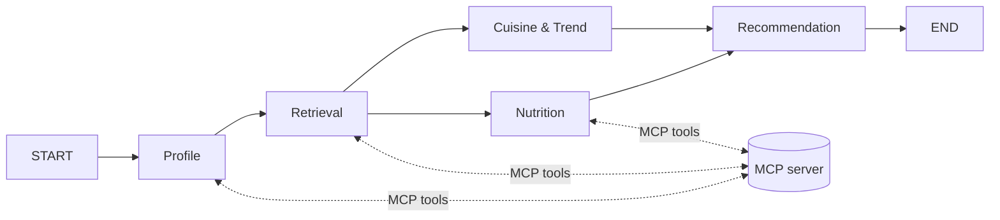

# Project Structure – File-by-File Reference

A quick reference for what every folder and file does, and how a request flows
through the system.

## 1. Folder overview

```text
RestRecommend/
├── restaurant_ai/          # All application code (one sub-folder per course module)
│   ├── config.py, llm.py, observability.py   # Shared "core" used everywhere
│   ├── data_pipeline/      # Module 1 – turn raw text/images into structured JSON
│   ├── rag/                # Module 2 – embeddings + ChromaDB vector search
│   ├── agents/             # Module 3 – 5 LangGraph agents + MCP client
│   ├── mcp_server/         # Module 4 – MCP server exposing data/search as tools
│   └── app/                # Gradio web UI that ties everything together
├── evals/                  # Evaluation metrics, test questions, saved results
├── tests/                  # Automated pytest unit tests
├── notebooks/              # Guided walkthrough notebook
├── data/                   # Raw inputs and processed (LLM-structured) outputs
├── vector_store/           # ChromaDB index (generated by `make index`, not in Git)
├── docs/                   # Extra documentation (this file)
└── README.md, Makefile, requirements.txt, .env.example, .gitignore, LICENSE, pytest.ini
```

## 2. Core files (`restaurant_ai/`)

| File | What it does | Key functions |
|---|---|---|
| [config.py](../restaurant_ai/config.py) | Central settings: file paths, model names, provider (Ollama or cloud), API keys, fusion weights, Phoenix URL. Reads values from `.env`. | `_env()` |
| [llm.py](../restaurant_ai/llm.py) | **Provider switch.** Every LLM call goes through here, so switching local Ollama ↔ cloud is only a `.env` change. Also handles vision (image) calls and safe JSON parsing. | `get_text_llm`, `get_vision_llm`, `ask_llm`, `ask_llm_async`, `ask_vision_llm`, `parse_json` |
| [observability.py](../restaurant_ai/observability.py) | Turns on Arize Phoenix tracing (if Phoenix is running) so every agent step, LLM call and tool call is visible at http://localhost:6006. `new_trace` gives each Gradio click its own trace. | `setup_tracing`, `new_trace` |

## 3. Module 1 – Data pipeline (`restaurant_ai/data_pipeline/`)

| File | What it does | Key functions | How to run |
|---|---|---|---|
| [schemas.py](../restaurant_ai/data_pipeline/schemas.py) | Pydantic model describing one restaurant record. Used to validate LLM output. | `Restaurant`, `RestaurantRecord` | – |
| [structure_restaurants.py](../restaurant_ai/data_pipeline/structure_restaurants.py) | Converts each restaurant paragraph in `restaurant_guide.txt` into JSON using a few-shot prompt. If validation fails, asks the LLM to repair it (max 3 tries). | `build_extraction_prompt`, `build_repair_prompt`, `structure_restaurant` | `python -m restaurant_ai.data_pipeline.structure_restaurants --limit 5` |
| [caption_recipes.py](../restaurant_ai/data_pipeline/caption_recipes.py) | Uses the vision LLM to describe each recipe photo and adds an `image_description` field. | `caption_prompt` | `python -m restaurant_ai.data_pipeline.caption_recipes --limit 3` |
| [caption_reviews.py](../restaurant_ai/data_pipeline/caption_reviews.py) | Downloads photos attached to user reviews and captions them in the context of the review text. | `download_image`, `caption_prompt` | `python -m restaurant_ai.data_pipeline.caption_reviews` |
| [store.py](../restaurant_ai/data_pipeline/store.py) | Simple JSON "database": load, add (LLM-structured), edit, delete. **Always backs up the file before saving.** Shared by the CLI and the Gradio app. | `load_restaurants`, `save_json_with_backup`, `add_restaurant_from_text`, `update_restaurant`, `delete_restaurant` | – |
| [manage_cli.py](../restaurant_ai/data_pipeline/manage_cli.py) | Interactive terminal menu to browse/add/edit/delete restaurants; keeps the vector index in sync. | `main`, `sync_index` | `make cli` |

## 4. Module 2 – Multimodal RAG (`restaurant_ai/rag/`)

| File | What it does | Key functions | How to run |
|---|---|---|---|
| [embeddings.py](../restaurant_ai/rag/embeddings.py) | Loads the two local embedding models: **MiniLM** for text (384 numbers) and **CLIP** for images and image-search text (512 numbers, shared image/text space). | `embed_texts`, `embed_images`, `embed_text_for_images` | – |
| [build_index.py](../restaurant_ai/rag/build_index.py) | Reads the processed JSON + recipe images and stores embeddings in ChromaDB (`vector_store/`). Re-running rebuilds it. | `main` | `make index` |
| [retriever.py](../restaurant_ai/rag/retriever.py) | All search logic: similarity search, metadata filters (location, price, rating), **late fusion** of recipe text + image scores, image→image search, and keeping the index updated on edits. | `search_restaurants`, `search_recipes`, `search_recipes_by_image`, `upsert_restaurant`, `delete_restaurant` | – |

ChromaDB collections: `restaurants`, `recipes_text`, `recipe_images`.

## 5. Module 4 – MCP server (`restaurant_ai/mcp_server/`)

| File | What it does |
|---|---|
| [server.py](../restaurant_ai/mcp_server/server.py) | A FastMCP server that wraps the data and the retriever as **MCP tools**. The agents never read files directly; they ask this server. The MCP client starts it automatically as a subprocess. |

| MCP tool / resource | Purpose |
|---|---|
| `search_restaurants` | Semantic search with optional location / max price / min rating filters |
| `search_recipes` | Late-fusion (text + image) recipe search, optional cuisine |
| `find_recipes_by_image` | Find recipes that look like an uploaded photo (CLIP) |
| `get_restaurant_details` | Full record for one restaurant by name |
| `get_restaurant_reviews` | User reviews (with image captions) for one restaurant |
| `get_user_dining_history` | Past reviews by a given user (used for personalization) |
| `get_recipe_details` | Full recipe (ingredients, steps) by name |
| `guide://california` (resource) | The original restaurant guide text as a readable document |

## 6. Module 3 – Agents (`restaurant_ai/agents/`)

| File | What it does | Key functions |
|---|---|---|
| [agent_configs.py](../restaurant_ai/agents/agent_configs.py) | Role, goal and backstory for each of the 5 agents (the course had 6; two overlapping ones were merged). Builds each agent's system prompt. | `AGENTS`, `system_prompt` |
| [state.py](../restaurant_ai/agents/state.py) | The shared dictionary passed between agents. List fields use `operator.add` so the parallel agents can both append safely. | `RecommendationState` |
| [mcp_client.py](../restaurant_ai/agents/mcp_client.py) | **Bridge from agents to MCP.** Starts the MCP server, loads its tools as LangChain tools, and helps call them. | `open_mcp_tools`, `call_tool`, `call_tool_json`, `tool_output_to_text` |
| [tool_loop.py](../restaurant_ai/agents/tool_loop.py) | A small ReAct loop: LLM picks tools → run them on MCP → feed results back → repeat until the LLM answers. | `run_tool_calling_loop` |
| [nodes.py](../restaurant_ai/agents/nodes.py) | The 5 agents as LangGraph nodes (see the table below). | `profile_agent`, `retrieval_agent`, `cuisine_agent`, `nutrition_agent`, `recommendation_agent` |
| [graph.py](../restaurant_ai/agents/graph.py) | Wires the agents into a LangGraph workflow (sequential + parallel), opens the MCP tools and runs a request. Also usable from the terminal. | `build_graph`, `run_recommendation` |
| [assistant.py](../restaurant_ai/agents/assistant.py) | "Ask the Concierge": a single LLM (the MCP **host**) that may call any MCP tool to answer free-form questions. | `ask_concierge` |
| [formatting.py](../restaurant_ai/agents/formatting.py) | Turns the final state into readable Markdown and an agent-step trace for the UI/CLI. | `format_recommendations`, `format_agent_trace` |

### The 5 agents

| # | Agent | Runs | What it does | MCP tools used |
|---|---|---|---|---|
| 1 | Profile Agent | Sequential | Extracts cuisine, budget, location, diet and mood from the request + the user's past reviews | `get_user_dining_history` |
| 2 | Retrieval Agent | Sequential | LLM chooses search tools and filters itself (ReAct). Falls back to direct tool calls if the LLM finds nothing | `search_restaurants`, `search_recipes`, `get_restaurant_details`, `get_restaurant_reviews` |
| 3 | Cuisine & Trend Analyst | **Parallel** with #4 | Scores how well each candidate's cuisine/style fits the user and notes trends | – (uses retrieved candidates) |
| 4 | Nutrition Agent | **Parallel** with #3 | Fetches recipe ingredients and checks each item against the user's dietary restrictions | `get_recipe_details` |
| 5 | Recommendation Agent | Waits for #3 and #4 | Picks the final 3 restaurants + 3 recipes and marks each as `grounded` (exists in the real data) | – |



## 7. App (`restaurant_ai/app/`)

| File | What it does | How to run |
|---|---|---|
| [gradio_app.py](../restaurant_ai/app/gradio_app.py) | Web UI with tabs: **Recommend** (5-agent workflow), **Ask the Concierge** (MCP host chat), **Food Photo Search** (vision caption + CLIP search), **Manage Restaurants** (add/edit/delete), **About**. | `make app` → http://localhost:7860 |

## 8. Evals (`evals/`)

| File | What it does |
|---|---|
| [golden_set.json](../evals/golden_set.json) | 8 test questions with the expected location, cuisine keywords and max price. |
| [metrics.py](../evals/metrics.py) | Simple metric functions (see the table below), including an LLM-as-judge and a data-quality report. |
| [run_evals.py](../evals/run_evals.py) | Runs the three evaluation levels, prints tables and saves results to `evals/results/eval_<timestamp>.json`. Use `make eval` (full) or `make eval-fast` (skips the agent runs). |

| Metric | Level | Meaning |
|---|---|---|
| Data quality | Module 1 | Missing names/locations, invalid prices, etc. in `restaurants.json` |
| Hit@k / Precision@k / MRR | Module 2 | Did vector search return relevant results, and how high up? |
| Completeness | Agents | Did we get 3 restaurants + 3 recipes? |
| Groundedness | Agents | % of recommendations that exist in the real data (no hallucinations) |
| Location / price match | Agents | Do recommendations respect the user's constraints? |
| Profile accuracy | Agents | Did the Profile Agent extract the right preferences? |
| LLM tool use | Agents | Did the LLM choose MCP tools itself, or was the fallback needed? |
| Judge score (1–5) | Agents | The local LLM rates how relevant the answer is |
| Latency | Agents | Seconds per request |

## 9. Tests, notebook, data and root files

| Path | What it does |
|---|---|
| [tests/test_core.py](../tests/test_core.py) | 15 fast unit tests (JSON parsing, schema, backups, graph wiring, MCP tools, metrics, late fusion, fallback, trace separation). Run with `make test`. |
| [notebooks/walkthrough.ipynb](../notebooks/walkthrough.ipynb) | Step-by-step tour of every module; good for learning and demos. |
| [data/README.md](../data/README.md) | Explains the data files and how to supply your own. |
| `data/raw/` | Inputs: `restaurant_guide.txt`, `recipes.json`, `user_reviews.json`, `recipe_images/` |
| `data/processed/` | Module 1 outputs: `restaurants.json`, `recipes_enriched.json`, `reviews_enriched.json`, `restaurant.schema.json`, `review_images/`, `backups/` |
| `vector_store/` | ChromaDB index built by `make index` (Git-ignored, can be regenerated) |
| [README.md](../README.md) | Project overview, setup, architecture, how to run |
| [Makefile](../Makefile) | Short commands: `setup`, `index`, `app`, `phoenix`, `cli`, `graph`, `eval`, `eval-fast`, `test` |
| [requirements.txt](../requirements.txt) | Python packages with pinned versions |
| [.env.example](../.env.example) | Settings template: copy to `.env` to change models or add a cloud API key |
| [.gitignore](../.gitignore) | Keeps secrets, the venv, generated files and course data out of Git |
| [pytest.ini](../pytest.ini) | Tells pytest where the tests live |
| [LICENSE](../LICENSE) | MIT license |

## 10. What happens when you click "Recommend"

1. `gradio_app.recommend()` calls `graph.run_recommendation()`.
2. `mcp_client.open_mcp_tools()` starts `mcp_server/server.py` and loads its 7 tools.
3. The **Profile Agent** fetches the user's dining history via MCP and extracts preferences.
4. The **Retrieval Agent** lets the LLM call `search_restaurants` / `search_recipes` via MCP;
   the server runs `rag/retriever.py` against ChromaDB.
5. The **Cuisine** and **Nutrition** agents run at the same time on the candidates
   (Nutrition fetches recipe ingredients via MCP).
6. The **Recommendation Agent** merges both opinions, picks the final list and marks each item `grounded`.
7. `formatting.py` renders the answer and the agent trace. If Phoenix is running, the whole
   run appears as one trace at http://localhost:6006.
